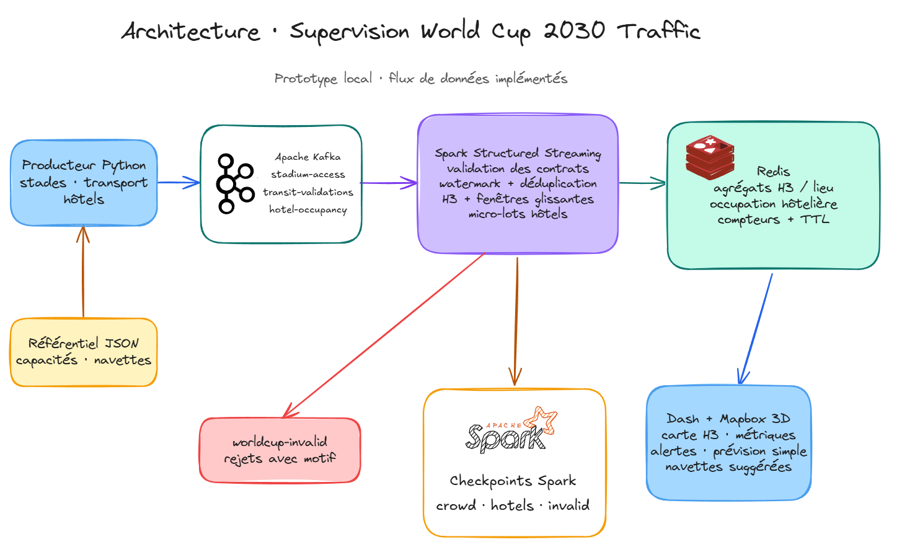

<h1 align="center">🏟️ World Cup 2030 Traffic Supervision</h1>

<p align="center">
  <strong>Real-time visibility into venue access, transit activity, and hotel occupancy.</strong><br>
  A streaming operations dashboard built with Kafka, Spark, H3, Redis, Dash, and Mapbox.
</p>

<p align="center">
  <a href="#architecture">Architecture</a> ·
  <a href="#capabilities">Capabilities</a> ·
  <a href="#quick-start">Quick start</a> ·
  <a href="#testing-and-performance">Testing</a> ·
  <a href="docs/implementation-plan.md">Roadmap</a>
</p>

<p align="center">
  
  
  
  
  
  
  
  
</p>

## Architecture



The pipeline ingests stadium access, transit validation, and hotel occupancy events. Spark validates records, writes invalid messages to `worldcup-invalid`, and publishes recent aggregates to Redis. Dash reads those aggregates to render the operations view.

[Open the editable Excalidraw diagram](docs/architecture.excalidraw) · [Read the architecture and data contracts](docs/architecture.md)

## Capabilities

| Event ingestion | Stream processing | Operations view |
| --- | --- | --- |
| Reproducible synthetic stadium and transit events, plus hotel occupancy snapshots. | Contract validation, event-time deduplication, H3 indexing, sliding windows, and reason-coded rejects. | 3D H3 map, city-level indicators, pressure alerts, a simple count forecast, and suggested shuttle routes. |

**Kafka topics:** `stadium-access`, `transit-validations`, `hotel-occupancy`, and the `worldcup-invalid` rejection stream. Spark maintains separate checkpoints for crowd events, hotel snapshots, and invalid records. Redis stores recent aggregate state with expiry; personal identifiers from source events do not enter the dashboard state.

## Quick start

**Requirements:** Python 3.10–3.13, [uv](https://docs.astral.sh/uv/), Java 17 or 21, and Docker Compose. A public Mapbox token enables the 3D map. The dashboard's Redis-backed panels remain available without a token.

From the repository root in PowerShell:

```powershell
uv sync
docker compose up -d
uv run python scripts/create_topics.py
```

Run each service in a separate terminal. Start Spark before the producer on the first run: the continuous stream starts at Kafka's `latest` offsets.

**Terminal 1 — stream processor**

```powershell
$env:PYSPARK_SUBMIT_ARGS = "--packages org.apache.spark:spark-sql-kafka-0-10_2.13:4.0.1 pyspark-shell"
uv run python spark_worldcup_traffic.py
```

**Terminal 2 — dashboard**

```powershell
$env:MAPBOX_ACCESS_TOKEN = "your-public-mapbox-token"  # Optional; needed for the 3D map
uv run python app_worldcup_control.py
```

**Terminal 3 — synthetic event producer**

```powershell
uv run python worldcup_event_producer.py --count 10000 --rate 500 --seed 2030
```

Open [http://127.0.0.1:8050/](http://127.0.0.1:8050/). The [`/health`](http://127.0.0.1:8050/health) endpoint checks Redis connectivity.

Configuration is read from environment variables; [`.env.example`](.env.example) lists the supported settings. A `.env` file is not loaded automatically. To inspect generated events without Kafka, run `uv run python worldcup_event_producer.py --sink stdout --count 5`. To process existing Kafka offsets once, use `uv run python spark_worldcup_traffic.py --available-now` with a fresh checkpoint.

## Testing and performance

```powershell
uv run --extra test python -m pytest -q
```

The load runner requires Kafka, Spark, and Redis to be running, with a dedicated `STREAM_ID` and no concurrent traffic:

```powershell
uv run python scripts/load_test.py --rates 1000 10000 25000 50000 --duration 60
uv run python scripts/render_load_report.py artifacts/load-results.json
```

**Performance status:** 50,000 events/s is a target, not a verified result. The current [load report](load_testing_report.pdf) records a failed Kafka preflight and contains no completed throughput stage. The runner counts events after Spark micro-batches; it does not measure per-event latency, system resource use, or browser rendering. Reproducible end-to-end measurements remain on the [roadmap](docs/implementation-plan.md).

## Repository map

| Path | Role |
| --- | --- |
| [`worldcup_event_producer.py`](worldcup_event_producer.py) | Publishes synthetic events to Kafka or stdout. |
| [`spark_worldcup_traffic.py`](spark_worldcup_traffic.py) | Validates streams and writes H3, venue, and hotel state to Redis. |
| [`app_worldcup_control.py`](app_worldcup_control.py) | Serves the Dash dashboard and Mapbox view. |
| [`worldcup/`](worldcup/) | Shared contracts, configuration, analytics, reference data access, and Redis storage. |
| [`scripts/`](scripts/) | Topic setup, load runner, and report generation. |
| [`tests/`](tests/) | Tests for contracts, streaming frames, analytics, Redis, and the dashboard. |

## Current scope

The [reference dataset](data/demo_reference.json) contains synthetic capacities, locations, and routes; it is not an authoritative source for 2030 operations. The forecast is a short-window linear baseline without historical evaluation. Shuttle routes are recommendations only and do not dispatch vehicles. Connecting real data sources requires authorization, retention rules, and a review of personal identifiers.
